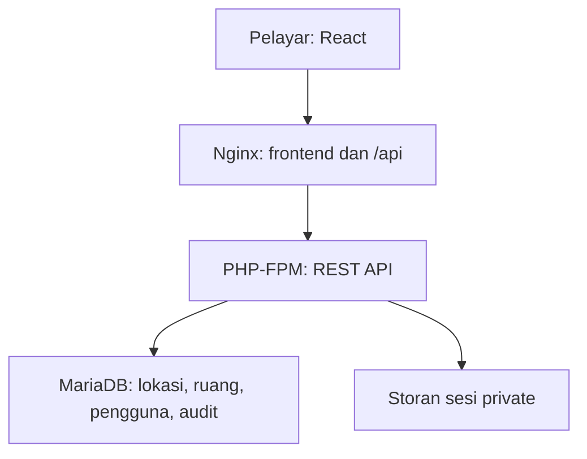

# Seni bina & keputusan

## Komponen

Satu origin untuk frontend dan API. React tidak mengakses MariaDB secara terus. Kata laluan database hanya berada di server. JavaScript tidak membaca cookie sesi HTTP-only.

## Model data

- `campuses` → `buildings` → `floors` → `rooms` menggunakan foreign key.
- Lokasi ruang unik pada gabungan `(building_code, floor_code, room_code)`.
- Medan utama ruang tersimpan sebagai kolum bertip: nama, kategori, jenis, PTJ, luas, kapasiti dan status.
- Spesifikasi tambahan disimpan sebagai objek JSON tervalidasi; sempadan sebagai senarai titik JSON.
- Koordinat menggunakan meter, dari penjuru kiri atas tingkat. Luas poligon dikira oleh PHP dan disimpan sebagai DECIMAL, bukan nilai daripada browser.
- `users` menyimpan hash, peranan, status aktif dan versi pengesahan.
- `audit_logs` merekodkan actor, tindakan, entiti, nilai sebelum/selepas dan masa UTC. API tidak menyediakan kemas kini/padam audit.
- `login_attempts` menyimpan fingerprint SHA-256 IP+e-mel dan masa untuk had cubaan. Rekod lama dibersihkan pada login berjaya.

## Penulisan ruang

1. CSRF dan pengguna disahkan; role mesti admin/manager.
2. Lock baris tingkat menyelaraskan semua perubahan geometri pada tingkat tersebut.
3. Identiti, spesifikasi dan koordinat divalidasi.
4. Poligon mesti simple, mempunyai sekurang-kurangnya 0.01 m², berada dalam dimensi tingkat dan tidak bertindih dengan ruang aktif lain.
5. Versi rekod diperiksa. Jika berbeza, API memulangkan 409 tanpa menimpa rekod.
6. Perubahan ruang dan audit di-commit dalam satu transaksi.

Paparan isometrik hanyalah unjuran daripada koordinat sama; ia tidak mengubah keluasan. Ruang tanpa geometri menggunakan luas manual dan tiada poligon direka secara automatik.

## Peranan

| Operasi | Admin | Manager | Viewer |
|---|---|---|---|
| Lihat ruang, pelan dan laporan | Ya | Ya | Ya |
| Daftar/sunting/arkib ruang | Ya | Ya | Tidak |
| Baca audit | Ya | Ya | Tidak |
| Tambah lokasi | Ya | Tidak | Tidak |
| Urus pengguna | Ya | Tidak | Tidak |
| Tukar kata laluan sendiri | Ya | Ya | Ya |

Skop keluaran ini satu organisasi. Pembatasan bacaan/penulisan mengikut kampus atau jabatan belum dilaksanakan. Jangan gunakan bagi organisasi berasingan dalam database sama.

## Hosting & operasi

Docker: Nginx + PHP-FPM + MariaDB, dengan volum data dan sesi. Web hanya di-bind ke localhost secara lalai. Produksi memerlukan reverse proxy HTTPS dan `COOKIE_SECURE=1`; `COOKIE_SECURE=0` untuk HTTP pembangunan sahaja.

Tanpa Docker: PHP 8.3+, pdo_mysql, MariaDB, Nginx/PHP-FPM. Root projek tidak boleh dijadikan document root server awam; hanya `frontend/dist` dan laluan `/api` ke `backend/public/index.php`.

Backend PHP native modular dipilih untuk memberi pakej runnable tanpa proses pemasangan Composer. Laravel bukan dependency keluaran ini; migrasi ke Laravel boleh dibuat selepas struktur modul dan kontrak API dipersetujui.

## Modul operasi

Lihat `MODULES.md` dan `OPERATIONS_API.md`. Migrasi `002_operations` menambah aset, aduan/kerja, PM, stok, tempahan, kos, utiliti, notifikasi dan lampiran. Perubahan aliran menggunakan transaksi dan lock rekod induk; bukti operasi disimpan dalam audit.

## Had diketahui

- Endpoint bootstrap memuat semua ruang aktif. Untuk rollout besar, pecahkan kepada pagination/per-floor fetch sebelum ujian kapasiti.
- Sesi berasaskan fail sesuai satu instance PHP atau storan sesi kongsi; deployment berbilang instance memerlukan session handler kongsi dan had cubaan login yang disemak.
- Luas, dimensi, perabot serta pintu mesti disemak dengan data ukur sebenar; fungsi pengesahan geometri bukan pengesahan juruukur.
- Had payload 256 KB dan poligon maksimum 200 bucu; ini bukan importer CAD.
- Rate limit login adalah gabungan IP dan e-mel; kawalan tambahan pada reverse proxy diperlukan untuk rollout awam besar.
- Keperluan retention audit, backup terenkripsi, SSO, pemulihan kata laluan dan scoping institusi perlu ditetapkan sebelum produksi.
